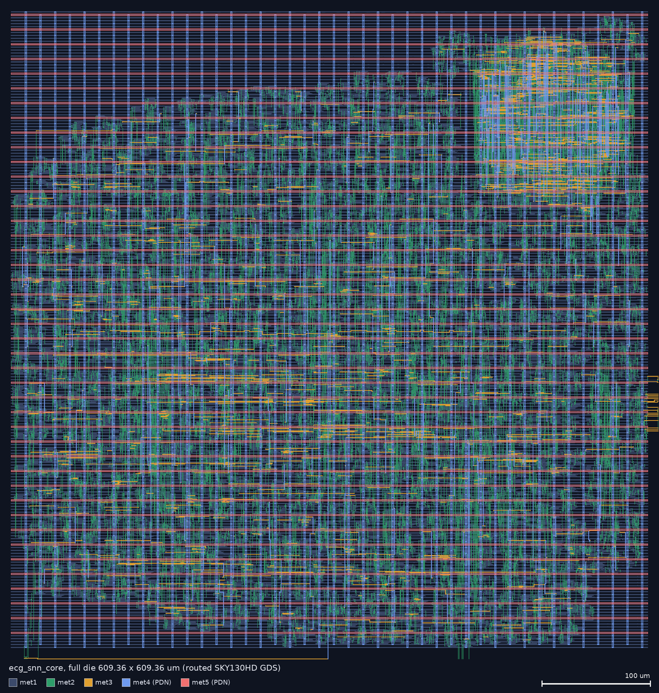
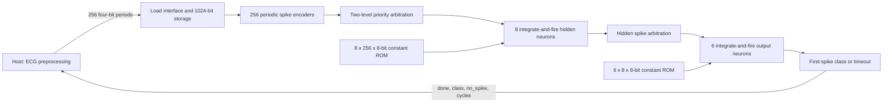

# ECG SNN inference core

This project adapts the MIT-licensed HDL-SpikingNet-ECG inference RTL to a
synchronous ASIC interface. Training and ECG preprocessing remain off chip.
See [the source audit](docs/RTL_AUDIT.md) before interpreting its predictions.
The full evidence, its coverage and its limitations are in
[reports/RESULTS.md](reports/RESULTS.md). This is a routed digital core, not
fabricated silicon or a fabrication-ready chip.

## Results at a glance

| | Result | Evidence type |
|---|---|---|
| Function | Final post-route netlist matches the reference RTL on all 500 supplied vectors (class, timeout, cycle count); directed protocol bench passes | zero-delay simulation |
| Timing | 40 ns (25 MHz): clean at TT (setup +29.86 ns, hold +0.047 ns). **Not clean at other corners:** ff hold −0.12 ns, ss slew/cap violations; fix pending | STA, TT/ff/ss library corners |
| Layout | 609.36 × 609.36 µm die; 16,632 cells (excluding fillers), 137,481 µm², 39.7 % utilization | routed GDS |
| Physical checks | Router 0; antenna 0; full-chip DRC with open_pdks mr deck: base 2 (met3 min-area at pins), clock-gated 0; LVS match; pin shapes missing on the drawing layer (fix pending) | open_pdks and ORFS decks, not foundry signoff |
| Power | 5.74 mW over a 20-vector, 628.861 µs window (3.61 µJ); 5.68 mW clock-on idle | OpenSTA estimate |
| Accuracy | Not computable: no labels supplied | — |



A clock-gated variant cuts the estimated clock-running idle power from 5.68 mW to 0.114 mW
(49.6× lower; 4.6 µW at a 1 MHz clock) and the 20-vector window energy from 3.61 to 2.14 µJ, at +3 % cell area and with
the same function, DRC/LVS and timing status; see [docs/CLOCK_GATING.md](docs/CLOCK_GATING.md).
The numbers above are for the ungated baseline.

Close-up: [reports/layout_closeup_readable.png](reports/layout_closeup_readable.png).
GDS: `physical/results/sky130hd/ecg_snn_core/base/6_final.gds`.

## Architecture




Each period determines how frequently its input neuron requests a spike.
Priority arbitration selects a pending input address. Eight ROMs look up its
weights and the hidden neurons add these weights to their membrane registers.
A hidden neuron exceeding 320 fires and clears its membrane. Its spike selects
one weight for each of six output neurons. An output neuron exceeding 112
triggers the class decision. Twelve input timer ticks without an output spike
also terminate inference. The timer tick is 2501 clocks, not exactly 2500.

## Port protocol

All actions occur on rising edges of `clk`. `reset` is **active high and
synchronous**. The host must meet the supplied input/output timing budget.

| Port | Direction | Meaning |
|---|---|---|
| clk, reset | input | Clock and synchronous reset |
| load_data[3:0] | input | Next period, in original index order 0 through 255 |
| load_valid | input | Accept data when high together with load_ready |
| load_ready | output | Can accept another period |
| input_complete | output | All 256 periods have been received |
| start | input | Start when input_complete=1 and busy=0 |
| busy | output | Accepted inference is in preparation or running |
| done | output | One-clock pulse; result registers valid |
| result_class[1:0] | output | Numeric class 0/1/2; 3 if no output spike |
| no_spike | output | Timeout indicator, preserved from reference |
| inference_cycles[15:0] | output | Number of RUN clocks, including result capture |

1. Assert reset for at least one edge; deassert synchronously.
2. Supply 256 periods using load_valid/load_ready; arbitrary pauses are allowed.
3. Assert start for one edge **after** input_complete is high. Start on the final
   load edge is not accepted because input_complete was not yet high.
4. Wait for done. No data is accepted while busy or after the buffer is full.
5. Read the latched outputs. Load the next beat without asserting external reset.
   The core automatically resets neuron state and requires a complete new beat.

Premature starts and starts while busy are ignored. Reset aborts an inference
and invalidates any partial input. Result registers remain stable between
completed inferences, except inference_cycles clears on an accepted start.
Hold start low normally; a permanently asserted start will automatically start
once a full beat has been loaded. There is no CDC, analog front end or pad ring.

## Reproduce functional verification (Ubuntu / WSL2)

Clone with submodules; the reference RTL is pinned as a submodule:

```bash
git clone --recursive https://github.com/thomvs-dev/snn-ecg-asic.git
```

The release ZIP additionally contains the complete evidence package.

```bash
sudo apt-get update
sudo apt-get install -y iverilog yosys python3
cd /mnt/d/snn
bash scripts/verify.sh
```

`vendor/HDL-SpikingNet-ECG` is the complete unchanged reference checkout at
`c6e7fee7040968e4cce95aa7d0394c6f039a247f`. The adaptation generator creates
constant case ROMs and records source SHA-256 hashes. The original bench needs
an explicit oscillator for Icarus; its intended period and stimulus are kept.
Predictions and cycle counts are compared for all 500 supplied vectors.
The same testbench runs against a Yosys generic synthesized netlist, followed
by a separate directed protocol test. These are simulation regressions, not
an exhaustive formal equivalence proof.

## Reproduce physical implementation

Use the exact official ORFS container digest in `reports/orfs_image_digest.json`,
with Docker running. The flow consumes the RTL and SDC from this project and
uses the container's matching scripts and `sky130hd` platform. The separately
inspected source checkout is in `tools/OpenROAD-flow-scripts`; its commit is
recorded separately because an image may contain a different revision.

```bash
sudo bash scripts/setup_ubuntu.sh
sudo bash scripts/run_physical.sh      # full ORFS flow; results already present
sudo bash scripts/physical_checks.sh   # KLayout DRC and LVS
bash scripts/verify_mapped.sh          # synthesis netlist: 500 vectors + protocol
bash scripts/verify_final.sh           # final post-route netlist: 500 vectors + protocol
sudo bash scripts/activity_power.sh    # activity and idle VCDs, OpenSTA power
pip install klayout pillow && python3 scripts/layout_images_readable.py
python3 scripts/summarize.py           # reports/final_summary.json
python3 scripts/package.py             # deliverables/ecg_snn_sky130_demo.zip
```

`scripts/inspect_layout.sh` produced the earlier all-layer renders
(`reports/layout_full.png`, `layout_closeup.png`) and the first power run. Do
not rerun the physical flow just to refresh documentation. Do not edit a shell
script while it is executing.

The script records actual container versions. `physical/` holds flow results,
logs and reports. The clock target is 40 ns (25 MHz), chosen so the inherited
2501-cycle timer approximates the original signal name's 100 us interval.
No multicycle or false-path exception is applied. Reset is timed like any
other synchronous input. External input/output budgets are 4 ns maximum,
0.5 ns minimum, with 10 fF output loads. These are interface assumptions,
not measurements of an external host.

## Interpretation and attribution

The supplied six-bit input values are reduced to their low four bits to
reproduce the upstream RTL. Do not describe this as validated ECG preprocessing.
No ground-truth labels or patient provenance accompany the vectors. Numeric
class meanings are not established by this repository. Accuracy/F1 cannot be
computed from agreement with the reference predictions.

The paper's 97.9% accuracy, 88.0% F1 and event-cost estimate of 1.78 uJ/beat
belong to its patient-specific evaluation, not this hardware implementation.
The hardware's topology and termination rule differ from the full paper model.

Upstream code and weights: Alireza Amirshahi, HDL-SpikingNet-ECG,
https://github.com/alirezaamir/HDL-SpikingNet-ECG . Preserve
`vendor/HDL-SpikingNet-ECG/LICENSE` with reused code. The local wrapper,
generation and verification scripts are supplied under the MIT license in
`LICENSE`. ORFS, its platform files and the SKY130 cell data retain their own
licences; see [docs/THIRD_PARTY.md](docs/THIRD_PARTY.md). The supplied IEEE PDF is not redistributed as
part of the hardware source package.
