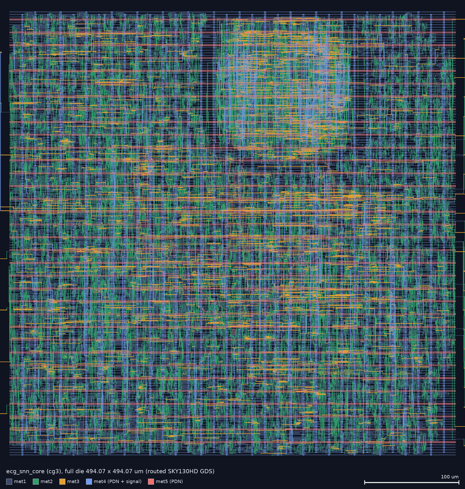
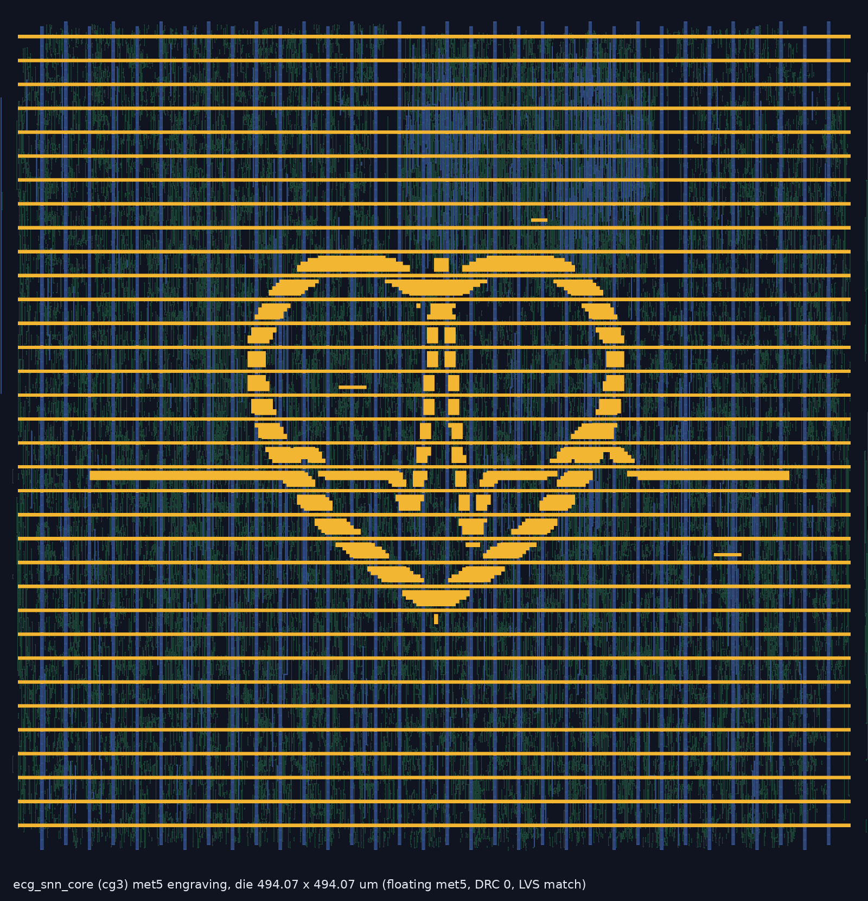
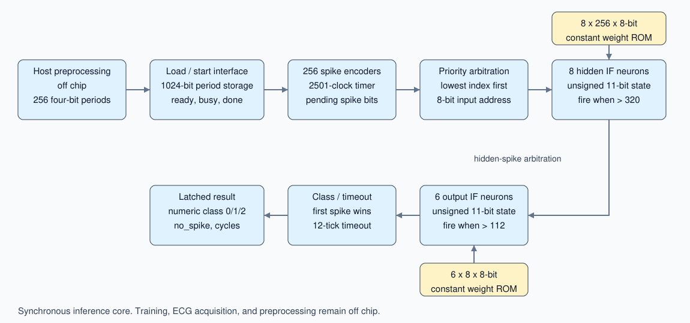
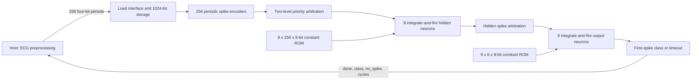

# ECG SNN inference core

This project adapts the MIT-licensed HDL-SpikingNet-ECG inference RTL to a
synchronous ASIC interface. Training and ECG preprocessing remain off chip.
See [the source audit](docs/RTL_AUDIT.md) before interpreting its predictions.
The full evidence, its coverage and its limitations are in
[reports/RESULTS.md](reports/RESULTS.md). This is a routed digital core, not
fabricated silicon or a fabrication-ready chip.

## Results at a glance

The final design is the **cg3** variant: the clock-gated core with a root clock
gate, timing margins for the fast and slow library corners, a
494.07 × 494.07 µm die, evenly spaced pins and a met5 heart/ECG engraving.
The ungated baseline (`base`) and the earlier clock-gated layouts (`cg`, `cg2`)
are kept for comparison; see [reports/cg3/comparison.md](reports/cg3/comparison.md).

| | Final design (cg3) | Evidence type |
|---|---|---|
| Function | Final post-route netlist matches the reference RTL on all 500 supplied vectors (class, timeout, cycle count); directed protocol bench passes. Random load/start/reset stimulus gives output traces identical to the ungated baseline RTL (RTL: 3 seeds × 400,000 clocks; post-route netlist: 100,000 clocks) | zero-delay simulation |
| Timing | 40 ns (25 MHz), no violations at three library corners. TT: setup +28.51 ns, hold +0.292 ns. ff (−40 °C, 1.95 V): setup +29.54 ns, hold +0.081 ns. ss (100 °C, 1.60 V): setup +25.59 ns, hold +0.759 ns. Max slew/cap/fanout violations: 0 at all three. Clock uncertainty is 0.4 ns for setup and 0.2 ns for hold; earlier variants used 0.4 ns for both, and with that value the ff hold slack would be −0.12 ns | STA, three library corners, one nominal extracted RC |
| Layout | 494.07 × 494.07 µm die; 15,672 cells (excluding fillers), 2,624 flip-flops, 141,826 µm², 63.6 % utilization | routed GDS |
| Physical checks | Antenna 0; DRC 0 with both the ORFS deck and the open_pdks mr deck (full chip, including pin metal and engraving); LVS match | open_pdks and ORFS decks, not foundry signoff |
| Power | Idle with the clock input running: 0.713 µW (baseline 5.68 mW, cg2 111 µW). 20-vector, 628.861 µs window: 3.21 mW / 2.02 µJ (baseline 3.61 µJ, −44 %). +3.2 % cell area against the baseline | OpenSTA estimate, TT 25 °C 1.8 V |



Clock gating uses three `sky130_fd_sc_hd__dlclkp` cells. A root gate on the
clock input passes the clock only while `reset`, `load_valid`, `start`, `busy`
or `done` is high, so the whole clock tree is static between beats. Behind it,
one gate clocks the 1,024 input-storage flip-flops only while a load is
accepted, and one clocks the 1,568 network flip-flops only outside IDLE.
Details and the power-versus-frequency sweep (run on the `cg` layout, two gates)
are in [docs/CLOCK_GATING.md](docs/CLOCK_GATING.md). All power values are tool
estimates, not measurements.

The fast-corner hold result depends on two changes together: 345 hold buffers
added with a 0.30 ns repair margin (TT hold slack +0.036 → +0.292 ns), and the
hold uncertainty reduced from 0.4 to 0.2 ns. The reason for the second is that
a hold check compares the same clock edge at launch and capture, so source
jitter cancels; see `flow_cg3/constraint.sdc`.

Close-up: [reports/layout_closeup_readable_cg3.png](reports/layout_closeup_readable_cg3.png).
GDS: `physical/results/sky130hd/ecg_snn_core/cg3/6_final.gds`.

### Chip art: heart and ECG trace on met5



`scripts/chip_art.py` adds a heart with an ECG trace on the top metal (met5)
between the power straps, after routing. The art is 56 floating met5 pieces
(8,583 µm²) on a 2 µm grid. It keeps at least 1.6 µm from all existing met5
and via4, and passes the met5 width, spacing, area and hole rules
(`reports/cg3/chip_art.txt`). Because it connects to nothing, LVS is unchanged
(match). Full-chip DRC after the engraving is 0 with both decks. The image is
rendered from the final GDS by `VARIANT=cg3 python3 scripts/chip_art_render.py`.

### Variant comparison

| | base | cg | cg2 | cg3 |
|---|---|---|---|---|
| Clock gates | 0 | 2 | 2 | 3 (adds root gate) |
| Die | 609.36 µm | 614.63 µm | 494.35 µm | 494.07 µm |
| Cells / area | 16,632 / 137,481 µm² | 17,184 / 141,565 µm² | 15,357 / 138,239 µm² | 15,672 / 141,826 µm² |
| Idle power (clock input running) | 5.68 mW | 0.114 mW | 0.111 mW | 0.000713 mW |
| 20-vector window energy | 3.61 µJ | 2.14 µJ | 2.04 µJ | 2.02 µJ |
| ff hold slack | −0.123 ns | −0.117 ns | −0.143 ns | +0.081 ns (0.2 ns hold uncertainty) |
| ss slew / cap violations | 439 / 45 | 464 / 50 | 547 / 58 | 0 / 0 |
| Full-chip DRC (mr deck) | 2 (met3 min-area at pins) | 0 | 0 | 0 |

## Architecture





Each period determines how frequently its input neuron requests a spike.
Priority arbitration selects a pending input address. Eight ROMs look up its
weights and the hidden neurons add these weights to their membrane registers.
A hidden neuron exceeding 320 fires and clears its membrane. Its spike selects
one weight for each of six output neurons. An output neuron exceeding 112
triggers the class decision. Twelve input timer ticks without an output spike
also terminate inference. The timer tick is 2501 clocks, not exactly 2500.

## Port protocol

All actions occur on rising edges of `clk`. `reset` is **active high and
synchronous**. The host must meet the supplied input/output timing budget.

| Port | Direction | Meaning |
|---|---|---|
| clk, reset | input | Clock and synchronous reset |
| load_data[3:0] | input | Next period, in original index order 0 through 255 |
| load_valid | input | Accept data when high together with load_ready |
| load_ready | output | Can accept another period |
| input_complete | output | All 256 periods have been received |
| start | input | Start when input_complete=1 and busy=0 |
| busy | output | Accepted inference is in preparation or running |
| done | output | One-clock pulse; result registers valid |
| result_class[1:0] | output | Numeric class 0/1/2; 3 if no output spike |
| no_spike | output | Timeout indicator, preserved from reference |
| inference_cycles[15:0] | output | Number of RUN clocks, including result capture |

1. Assert reset for at least one edge; deassert synchronously.
2. Supply 256 periods using load_valid/load_ready; arbitrary pauses are allowed.
3. Assert start for one edge **after** input_complete is high. Start on the final
   load edge is not accepted because input_complete was not yet high.
4. Wait for done. No data is accepted while busy or after the buffer is full.
5. Read the latched outputs. Load the next beat without asserting external reset.
   The core automatically resets neuron state and requires a complete new beat.

Premature starts and starts while busy are ignored. Reset aborts an inference
and invalidates any partial input. Result registers remain stable between
completed inferences, except inference_cycles clears on an accepted start.
Hold start low normally; a permanently asserted start will automatically start
once a full beat has been loaded. There is no CDC, analog front end or pad ring.

In cg3 the internal clock runs only while `reset`, `load_valid`, `start`, `busy`
or `done` is high. To get the idle power above, the host holds `load_valid` and
`start` low between beats; the clock input itself may keep running. The port
behaviour is otherwise identical to the ungated core.

## Reproduce functional verification (Ubuntu / WSL2)

Clone with submodules; the reference RTL is pinned as a submodule:

```bash
git clone --recursive https://github.com/thomvs-dev/snn-ecg-asic.git
```

The release ZIP additionally contains the complete evidence package.

```bash
sudo apt-get update
sudo apt-get install -y iverilog yosys python3
cd /mnt/d/snn
bash scripts/verify.sh
```

`vendor/HDL-SpikingNet-ECG` is the complete unchanged reference checkout at
`c6e7fee7040968e4cce95aa7d0394c6f039a247f`. The adaptation generator creates
constant case ROMs and records source SHA-256 hashes. The original bench needs
an explicit oscillator for Icarus; its intended period and stimulus are kept.
Predictions and cycle counts are compared for all 500 supplied vectors.
The same testbench runs against a Yosys generic synthesized netlist, followed
by a separate directed protocol test. These are simulation regressions, not
an exhaustive formal equivalence proof.

## Reproduce physical implementation

Use the exact official ORFS container digest in `reports/orfs_image_digest.json`,
with Docker running. The flow consumes the RTL and SDC from this project and
uses the container's matching scripts and `sky130hd` platform. The separately
inspected source checkout is in `tools/OpenROAD-flow-scripts`; its commit is
recorded separately because an image may contain a different revision.

```bash
sudo bash scripts/setup_ubuntu.sh
sudo bash scripts/run_physical.sh      # full ORFS flow; results already present
sudo bash scripts/physical_checks.sh   # KLayout DRC and LVS
bash scripts/verify_mapped.sh          # synthesis netlist: 500 vectors + protocol
bash scripts/verify_final.sh           # final post-route netlist: 500 vectors + protocol
sudo bash scripts/activity_power.sh    # activity and idle VCDs, OpenSTA power
pip install klayout pillow && python3 scripts/layout_images_readable.py
python3 scripts/summarize.py           # reports/final_summary.json
python3 scripts/package.py             # deliverables/ecg_snn_sky130_demo.zip
```

The commands above reproduce the baseline. The final cg3 design has its own
driver; each stage can be run alone with `ONLY`:

```bash
sudo bash scripts/run_cg3.sh                                   # RTL checks, full cg3 flow and all checks
bash scripts/verify_cg3.sh                                     # RTL only: 500 vectors, protocol, root gate, random traces
sudo ONLY="sta" bash scripts/run_cg3.sh                        # three-corner STA on the routed design
VARIANT=cg3 python3 scripts/layout_images_readable.py          # layout renders
VARIANT=cg3 python3 scripts/chip_art_render.py                 # reports/chip_art_cg3.png
```

`scripts/run_cg2.sh` reproduces the previous layout (two gates, no margins).
The post-processing always starts from `6_1_merged.gds`: pin metal
(`scripts/pin_metal.py`), then the npc.2 spacing fix (`scripts/npc_fix.py`),
then the engraving (`scripts/chip_art.py`), then DRC and LVS.

`scripts/inspect_layout.sh` produced the earlier all-layer renders
(`reports/layout_full.png`, `layout_closeup.png`) and the first power run. Do
not rerun the physical flow just to refresh documentation. Do not edit a shell
script while it is executing.

The script records actual container versions. `physical/` holds flow results,
logs and reports. The clock target is 40 ns (25 MHz), chosen so the inherited
2501-cycle timer approximates the original signal name's 100 us interval.
No multicycle or false-path exception is applied. Clock uncertainty is 0.4 ns
(cg3: 0.4 ns setup, 0.2 ns hold). Reset is timed like any
other synchronous input. External input/output budgets are 4 ns maximum,
0.5 ns minimum, with 10 fF output loads. These are interface assumptions,
not measurements of an external host.

## Interpretation and attribution

The supplied six-bit input values are reduced to their low four bits to
reproduce the upstream RTL. Do not describe this as validated ECG preprocessing.
No ground-truth labels or patient provenance accompany the vectors. Numeric
class meanings are not established by this repository. Accuracy/F1 cannot be
computed from agreement with the reference predictions.

The paper's 97.9% accuracy, 88.0% F1 and event-cost estimate of 1.78 uJ/beat
belong to its patient-specific evaluation, not this hardware implementation.
The hardware's topology and termination rule differ from the full paper model.

Upstream code and weights: Alireza Amirshahi, HDL-SpikingNet-ECG,
https://github.com/alirezaamir/HDL-SpikingNet-ECG . Preserve
`vendor/HDL-SpikingNet-ECG/LICENSE` with reused code. The local wrapper,
generation and verification scripts are supplied under the MIT license in
`LICENSE`. ORFS, its platform files and the SKY130 cell data retain their own
licences; see [docs/THIRD_PARTY.md](docs/THIRD_PARTY.md). The supplied IEEE PDF is not redistributed as
part of the hardware source package.

## License

The wrapper RTL, clock-gating logic, flow configuration, testbenches and scripts
in this repository are released under the [MIT License](LICENSE).
Third-party parts keep their own licences:

- `vendor/HDL-SpikingNet-ECG`: MIT License, copyright Alireza Amirshahi; see
  `vendor/HDL-SpikingNet-ECG/LICENSE`. Keep that notice with any reused code or weights.
- OpenROAD-flow-scripts, the `sky130hd` platform files and the SkyWater SKY130 PDK
  and cell libraries: their own licences; see [docs/THIRD_PARTY.md](docs/THIRD_PARTY.md).
- The IEEE paper (Amirshahi and Hashemi, IEEE TBCAS 2019) is not included and is not covered by this licence.
